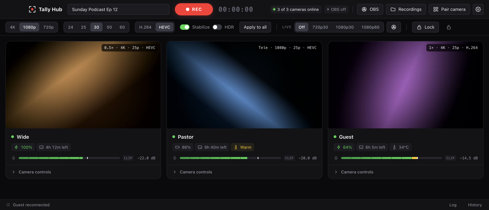
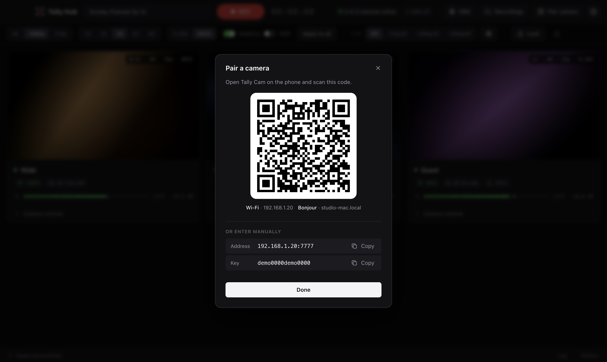
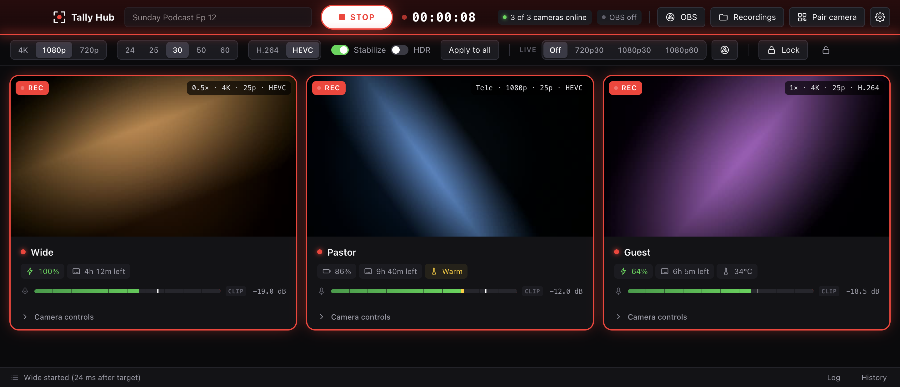
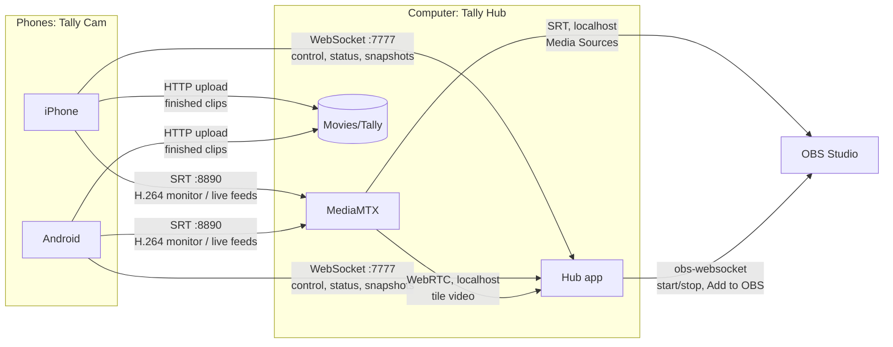

# Tally — synced multi-camera recording with phones

**Turn phones into a synced multi-camera rig: one button records every iPhone and Android, live-switch them in OBS.**

[](LICENSE)
[](#quick-start)
[](#quick-start)
[](https://github.com/BlackSentryDevXo/tally-multicam/releases)



Tally is named after the red tally light that tells a crew which camera is live. It has two parts:

- **Tally Hub**: the control room on your Mac or Windows PC (`hub/`, Electron).
- **Tally Cam**: a pro camera app for iPhone and Android (`mobile/`, Expo / React Native, VisionCamera).

Press **REC** once and every phone, plus OBS, starts recording at the same instant. Each tile shows that camera's
live picture, audio level, battery, storage and temperature. Phones can also feed OBS live (up to 1080p60) while
they record full quality on their own, and when you press **STOP** every clip copies to your computer.

## Why Tally

Churches, podcasts and small studios often film with the phones they already have: a wide shot, one on the host,
one on the guest. Running around to start and stop each one, guessing at framing, and lining up clips afterwards
wastes time and loses takes. Tally makes the phones behave like one camera system: framed from one screen,
started and stopped together, matched in settings, monitored for battery and heat, and copied back automatically.

## Features

**Recording & sync**
- One button (or **Space**) starts and stops every phone and OBS together, clock-synced across Wi-Fi (phones
  typically start within a few frames of each other).
- A start beep gives editors a clean spike for *sync by audio* (DaVinci Resolve, Premiere) to get frame-perfect.
- Any phone's own record button starts and stops **all** cameras, so the person at a camera can roll the shoot.
- **Apply to all**: one resolution, frame rate, codec, stabilization and HDR setting for every camera.
- Finished clips copy to `~/Movies/Tally/<date>_<session>/<camera>.mp4` (Windows: `Videos\Tally\`), and a backup
  copy is saved to each phone's gallery. Nothing is ever deleted from the phones.

**Pro camera (Tally Cam)**
- Lens chips (0.5×, 1×, telephoto, front), pinch to zoom.
- Tap to focus and expose; **double-tap or long-press for AE/AF lock**; drag to adjust exposure.
- Manual focus, ISO, shutter and white balance with scrub rulers that only move on a deliberate sideways drag
  (iPhone, and Android phones that support manual sensor control, e.g. Galaxy S21).
- One-tap resolution and frame-rate picker that only offers what the lens supports (4K60 only where it works);
  HEVC/H.264 (iPhone), stabilization, HDR.
- Mains 50/60 Hz flicker warnings with shutter-angle readout, and a **Podcast** preset (25/30 fps, 180° shutter,
  locked white balance, stabilization off).
- Grid, histogram, optional audio meter, battery, storage, time-left and temperature in a compact status line.
- The controls rotate themselves with the phone, so the iPhone's Portrait Lock can stay on.
- Dims the screen while recording to save heat and battery; tap to wake.

**Live to OBS**
- Each phone hardware-encodes H.264 and streams it over SRT to the hub: 720p30, 1080p30 or 1080p60
  (25/50 fps for 50 Hz regions).
- **Add to OBS** creates one Media Source per camera, a multiview scene, and a full-frame scene per camera,
  ready to switch. Running it again updates instead of duplicating.
- OBS start/stop recording follows the hub's REC button (via OBS's built-in WebSocket).

**Monitoring**
- Smooth tile video (hardware-encoded 720p monitor feed, played over WebRTC on the same computer), with JPEG
  snapshots as fallback.
- Per-camera chips: battery, recording time left, temperature (Warm/Hot/Critical, °C on Android), audio meter.
- Pre-record check warns about offline phones, low battery, low storage or hot phones.
- Remote control per camera: lens, zoom, exposure, torch, tap-to-focus on the tile, AE/AF/WB lock.

**Reliability**
- A phone that drops off Wi-Fi keeps recording and copies its clip when it's back.
- If the hub crashes or is quit mid-take, the phones keep recording and the reopened hub picks the take up again.
- Clips are recorded to the phone's documents folder and recovered after a crash; uploads retry with backoff.
- Heat protection: live feeds step down (30 fps, lower bitrate, then off) when a phone gets hot; the local
  recording always wins.
- The hub keeps the computer awake while recording, uploading or connected.

| Pairing | Recording |
|---|---|
|  |  |

## How it works



The full message reference is in [docs/PROTOCOL.md](docs/PROTOCOL.md).

## Quick start

Download the latest build from **[Releases](https://github.com/BlackSentryDevXo/tally-multicam/releases)**.

### Tally Hub: macOS (Apple silicon)
1. Download `Tally-Hub-macOS-arm64.zip`, unzip it and move **Tally Hub** to Applications.
2. **First launch:** the app isn't notarized by Apple, so right-click **Tally Hub → Open → Open**
   (or System Settings → Privacy & Security → **Open Anyway**). After that it opens normally.
3. If macOS asks whether Tally Hub (and `mediamtx`) may **accept incoming connections**, click **Allow**.
   See [macOS firewall](#macos-firewall) if cameras can't connect.

Intel Macs: run it from source (see [Building from source](#building-from-source)); packaged Intel builds are on
the roadmap.

### Tally Hub: Windows (x64)
1. Download `Tally-Hub-Windows-x64.zip`, unzip it anywhere and run `Tally Hub.exe`.
2. **SmartScreen** may warn that the app is unrecognized: click **More info → Run anyway**.
3. When **Windows Defender Firewall** asks about **Tally Hub** and **mediamtx.exe**, click **Allow access** with
   *Private networks* ticked, or no camera can connect.

> The Windows build is cross-packaged and has **not yet been tested on a real Windows PC**. The hub's code paths
> are platform-aware (paths, firewall hints, MediaMTX binary), but please report anything that doesn't work.

### Tally Cam: Android (8.0 and newer)
Download `Tally-Cam-Android.apk` to the phone and open it (allow *Install unknown apps* for your browser or file
manager when asked).

### Tally Cam: iPhone
Apple only allows App Store / TestFlight distribution, so you build it yourself with your own Apple account (free
or paid): see [iPhone](#tally-cam-iphone-1). With a free account the app has to be reinstalled every 7 days.

### Pair and shoot
1. Put the computer and phones on the **same Wi-Fi**.
2. In Tally Hub click **Pair camera**. On each phone open Tally Cam, name the camera ("Wide", "Pastor", "Guest")
   and scan the code. Phones remember the hub after that.
3. Press **REC**. Press **STOP**. Clips appear in your Tally recordings folder.

## On the day: checklist

1. **Network:** computer and phones on the same Wi-Fi. Guest and church networks often block devices from seeing
   each other (client isolation); use the computer's hotspot or a small dedicated router instead. If no phone
   connects within 30 s, the pairing dialog lists what to check.
2. **Power:** plug the phones in for long sessions. Turn on Do Not Disturb.
3. **iPhone:** keep Tally Cam in the foreground (iOS stops the camera in the background). Guided Access helps.
4. **Settings:** **Apply to all** for one format everywhere. In 50 Hz countries (Europe, Africa, most of Asia)
   use 25 or 50 fps to avoid flicker (Settings → Mains power).
5. **Framing:** click a tile to focus there, then **Lock** AE/AF/WB so colour and brightness don't drift.
6. **Roll:** name the session and press **REC** (or **Space**). The beep at the start is your sync point.
7. **Wrap:** press **STOP**. Each tile shows a progress bar, then ✓ copied.

**Camera controls → Close camera** disconnects a phone for now (it reconnects when someone taps it on the phone);
**Forget camera** makes the phone drop the pairing and return to its pairing screen.

## Live switching in OBS

1. In OBS: **Tools → WebSocket Server Settings → Enable**, and copy the password.
2. In Tally Hub: click **OBS**, tick the box, paste the password.
3. Pick a quality under **LIVE**: 720p30, 1080p30 or 1080p60.
4. Click **Add to OBS**. You get `Tally · <camera>` Media Sources, a **Tally Cameras** multiview scene, and a
   `Tally – <camera>` scene for each phone. Switch between them like any other scene.

Each tile's **LIVE** badge shows the bitrate the hub receives, plus **OBS** once OBS is reading it. Expect a
fraction of a second of delay on a good network. Three phones at 1080p60 need roughly 36 Mb/s of Wi-Fi; use 5 GHz.

## Editing

Clips start within a few frames of each other. For frame-perfect alignment, use your editor's audio sync:
DaVinci Resolve → *Auto Sync Audio → Based on Waveform*, or Premiere → *Synchronize → Audio*. The start beep gives
it a clean spike to lock onto.

## Building from source

Requirements: Node.js 20+ and npm. Phones also need the Android SDK (with JDK 21) and/or Xcode.

### Tally Hub
```sh
cd hub
npm install
npm run fetch:mediamtx        # MediaMTX for this machine (pinned version, sha256-checked) into hub/bin/<platform>/
npm start                     # dev copy with its own settings folder ("Tally Hub Dev")
npm test                      # integration test: starts its own hub on test ports and simulates phones
```
Intel Macs: `node build/fetch-mediamtx.js darwin_amd64`, then `npm start`.

**Package for macOS (Apple silicon):**
```sh
security find-identity -v -p codesigning      # pick an "Apple Development: Name (ID)" line
TALLY_SIGN_ID="Apple Development: Name (ID)" npm run package:mac
```
Any Apple Development identity works, including one from a free Apple ID added in Xcode. Signing your own copy
makes the macOS firewall remember its permission (see [macOS firewall](#macos-firewall)).

**Package for Windows** (works from macOS too, no Wine needed):
```sh
node build/fetch-mediamtx.js windows_amd64
npm run package:win                            # -> dist/Tally Hub-win32-x64/
```

### Tally Cam: Android
```sh
cd mobile
npm install                                    # also applies the VisionCamera patch (patch-package)
npm test                                       # clock-sync, pairing and layout tests
npx expo run:android --variant release         # build and install on a USB-connected phone
```
The APK lands in `mobile/android/app/build/outputs/apk/release/`.

**Signing with your own release key:** create `~/.tally/signing.properties` (never commit it):
```properties
TALLY_UPLOAD_STORE_FILE=/absolute/path/to/your-release.keystore
TALLY_UPLOAD_KEY_ALIAS=yourAlias
TALLY_UPLOAD_STORE_PASSWORD=…
TALLY_UPLOAD_KEY_PASSWORD=…
```
You can also set the same names as environment variables. Without a key, release builds use the debug key, which
is fine for testing but not for distributing. Back up your keystore: every update must be signed with the same key.

### Tally Cam: iPhone
```sh
cd mobile
npm install
mkdir -p ~/.tally && echo "YOURTEAMID" > ~/.tally/apple-team-id   # or: export APPLE_TEAM_ID=YOURTEAMID
npx expo run:ios --device --configuration Release
```
Find your Team ID in Xcode → Settings → Accounts → your team (or at developer.apple.com → Membership). With a
free account the app expires after 7 days; rerun the command to reinstall.

## Troubleshooting

### macOS firewall
The macOS firewall is **off by default** on most Macs, and then nothing is needed. If it's on:
- macOS asks whether Tally Hub may accept incoming connections: click **Allow**. Tally Hub also shows a
  **"macOS Firewall is blocking cameras"** banner with an **Allow Tally Hub** button.
- The release build is ad-hoc signed (not tied to a developer certificate), and macOS may not keep **Allow** for
  it across launches or updates. Either click **Allow** (or the banner) again when it appears, or sign your own
  copy with any Apple Development identity (`TALLY_SIGN_ID=… npm run package:mac`; a free Apple ID works), which
  makes the permission stick.

### Other issues
- **Phone stuck on "Searching for Tally Hub…":** same Wi-Fi? Firewall allowed? On iPhone: Settings → Privacy &
  Security → **Local Network** → Tally Cam **on**. Guest Wi-Fi with client isolation blocks phones from reaching
  the computer.
- **"Pairing rejected":** the hub's key changed; scan the code again.
- **Tile says "No preview from this camera yet":** the phone isn't sending pictures; check it's online and see the
  hub log for the reason.
- **Tile shows "NO MONITOR" / "NO FEED":** the phone isn't sending its video feed. Check that MediaMTX is running
  (the log says if it's missing) and that the firewall allows `mediamtx` (UDP 8890).
- **"Warm" / "Hot" chips:** shade the phone, give it airflow, lower the live quality or turn off
  Settings → Smooth preview. The hub warns before recording if a phone is hot.
- **Android 8–9 and budget phones:** manual ISO/shutter/focus/WB only appear on phones that support manual sensor
  control. The live feed on Android uses an extra camera stream and a CPU copy; if 4K recording or the feed
  struggles, use 720p30 live or keep live off. The optional audio meter pauses during recording on Android 8–9.
- **A clip didn't copy:** it stays on the phone (and in its gallery) and retries automatically.
- **Log file:** Settings → **Open log** (`~/Library/Application Support/Tally Hub/hub.log`, or
  `%APPDATA%\Tally Hub\hub.log` on Windows).

## Roadmap

- Over-the-internet mode (a cloud relay keyed by room code) for cameras that aren't on the same network.
- A Windows build tested on real PCs, and a packaged Intel Mac build.
- TestFlight / App Store and Play Store distribution.

## Contributing

Issues and pull requests are welcome; see [CONTRIBUTING.md](CONTRIBUTING.md).

## License

MIT, see [LICENSE](LICENSE). Bundled third-party components and their licenses are listed in
[THIRD_PARTY_NOTICES.md](THIRD_PARTY_NOTICES.md).

## Acknowledgements

Built on
[react-native-vision-camera](https://github.com/mrousavy/react-native-vision-camera),
[MediaMTX](https://github.com/bluenviron/mediamtx),
[SRT](https://github.com/Haivision/srt),
[RootEncoder](https://github.com/pedroSG94/RootEncoder),
[Expo](https://expo.dev),
[Electron](https://www.electronjs.org) and
[OBS Studio](https://obsproject.com).
